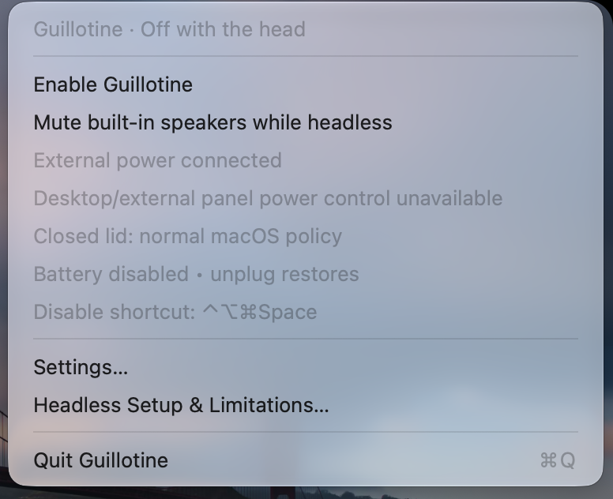

# Guillotine

**Off with the head.** A native menu bar switch that powers off an Apple Silicon MacBook’s physical panel and keyboard backlight while retaining its logical display for remote access.

<p align="center">
  
</p>

**Keep the lid open for the current supported workflow.** Enable Guillotine to turn off the panel and keyboard backlight, then use Caffeine independently if you want to prevent idle sleep. With the lid open, Guillotine immediately requests panel-off when macOS re-enables the built-in display; other display changes wait for the layout to settle. Panel power is not rewritten every second. No brightness-zero substitute is used for the panel.

**Closed lid on AC power has worked in testing, without the helper.** With the lid closed, external power connected, the panel off, and another display active, macOS treated the Mac as docked (clamshell mode) and a remote stream kept running well past the idle-sleep timeout, with Caffeine on. The other display can be a stream's virtual display or Guillotine's own anchor display. This was seen on one MacBookPro18,1 running macOS 27.0.1 and is not guaranteed elsewhere. It does not work on battery: unplugging a MacBook with the lid closed put it to sleep even with Guillotine enabled and Caffeine running (confirmed 2026-10-13), as macOS sleeps a MacBook shortly after the lid closes on battery whatever apps are running.

**The Prevent closed-lid sleep option is still experimental, WIP, and probably not working on battery.** It uses the optional approved privileged helper to disable system sleep globally, including ordinary and manual sleep, and has not been tested apart from clamshell mode. Do not rely on it for unattended closed-lid access, especially on battery. Earlier closed-lid failures, including a WindowServer watchdog restart when the lid was reopened, were most likely caused by powering the panel off while it was the only display, which Guillotine now prevents.

## Install with Homebrew

```sh
brew install --cask benjweaver/guillotine/guillotine
```

Update with `brew upgrade --cask benjweaver/guillotine/guillotine`. The public tap
uses ordinary GitHub release URLs and SHA-256 checksums. Installation requires no
GitHub token or custom download strategy.

Before upgrading, Restore in Guillotine. Reload the helper in Settings if the
release changes it. Before uninstalling, Restore, Remove Helper, and disable
launch at login. Recovery journals are retained, including with `brew zap`.

## Supported setup

macOS 13+, Apple Silicon MacBooks. Hardware checked: MacBookPro18,1, macOS 27.0.1. Panel power uses private IOMobileFramebuffer APIs; keyboard brightness uses private CoreBrightness APIs, with zero readback verified. Both can change after OS updates. Intel, desktop, and external-panel power control are not implemented; the universal executable reports unsupported hardware clearly.

Guillotine leaves display layout, virtual displays, network interfaces, streaming processes, and authentication alone. Retaining a logical framebuffer is different from guaranteeing capturable frames after lid closure. Physical lid-close sleep prevention and a progressing remote stream must both be tested on the exact hardware and host version. When the built-in panel would be the only display, Guillotine creates one small private virtual display (named Guillotine, 1280×720) for as long as it is enabled and removes it on restore; it is not a capture target and is not a substitute for streaming.

## Use

1. Connect external power or opt into **Allow on battery** (off by default). Plugged in but not charging counts as external power.
2. Leave the lid open and **Prevent closed-lid sleep (experimental, WIP)** off for normal use. If you are testing that option, choose **Install Helper…** and approve Guillotine under macOS **Login Items & Extensions → Allow in the Background**. Keep the app in Applications. Administrator approval is required by macOS; approval does not establish reliable closed-lid streaming.
3. Choose **Enable Guillotine**. With the panel off and no other display, macOS reports the built-in display stuck and restarts WindowServer, so Guillotine keeps one other display active: a stream's virtual display or an external monitor if present, otherwise its own small virtual display. If the stream display goes away, Guillotine refreshes its anchor display and keeps the panel off; if macOS will not provide an active independent display, it powers the panel on to protect WindowServer. Activation also requires working power notifications, a registered restore shortcut, both physical controls, and, when selected, a working privileged lease. Failed activation restores owned changes and reports an error.
4. Restore with **Control–Option–Command–Space**, the menu, or Quit. Fn is optional locally; the inspected Vibepollo source does not forward it. Lock-screen/Secure Input shortcut delivery is not yet certified. Normal lock and authentication remain in force.
5. Lock never changes the active mode. Sleep/wake restoration is optional and off by default. With closed-lid support off, sleep follows the user’s policy. With it on, the global sleep block lasts until restoration.
6. Unplugging restores unless battery use is allowed. Turning battery use off on battery restores immediately. Reconnecting never reactivates. Launch/login starts restored.
7. **Sleep at a battery percentage** defaults to 10% and can be turned off entirely. Choose any whole percentage from 1–100. While headless on battery, reaching the threshold restores physical controls and the owned power settings, then requests sleep. The option has no effect on AC; an unreadable battery percentage never triggers a cutoff. Turn it off to leave depleted-battery behavior to macOS.
8. **Low Power Mode** is independently optional: Off (default), Whenever on battery, or At a battery percentage (20% preset; editable 1–100). It requires the approved power helper even with closed-lid support off. Low Power Mode can reduce heat on battery, which may help avoid thermal limits; it can also reduce performance. Only the battery power profile is changed. Plugging in, opting out, ending the session, or losing the helper lease restores the previous setting. All battery options apply live while headless.
9. Serious/critical macOS thermal pressure on battery restores physical controls and the owned sleep override, then requests system sleep. This uses OS thermal pressure, not a fabricated Celsius sensor. No deliberate heat test is appropriate. Another utility’s pre-existing sleep block can still reject sleep.

**Mute built-in speakers while headless** in the menu is optional and off by default. It applies within one second while headless, and unchecking it restores the prior mute state. Volume and routing stay unchanged; virtual, aggregate, USB, HDMI, and Bluetooth outputs are excluded. This silences playback through built-in audio; it does not claim to power down the audio hardware or mute remote streaming audio. Already-muted speakers stay muted. The guard journals changes by stable device UID and restores them on disable, quit, power-policy cutoff, or lease expiry; killed-guard recovery runs when the app reopens. A current unmuted value is preserved during restoration. Identical mute writes from another app cannot be distinguished. During a session, the guard reapplies mute once per second.

Panel power-off is requested at activation and after a display layout change or wake while the lid is open. Built-in display enable events request off immediately, without a settling delay. Other event bursts are coalesced with a one-second settling delay and at least three seconds between their off requests. macOS may briefly relight the panel before its notification reaches Guillotine. Duplicate layout notifications, maintenance ticks, and lease renewals send no panel requests. Closed or unknown lid state and system sleep suppress event-driven reapplication. Restoration requests panel-on. Keyboard backlight and optional speaker mute remain periodically enforced. Status indicates ownership, not an electrical power measurement.

The disable shortcut also requests built-in panel power-on when Guillotine already reports OFF. This explicit rescue helps if the physical panel stayed dark after a stream ended; it does not change logical display layout. Ordinary startup recovery only restores owned state.

Same-user explicit rescue without changing lock state:

```sh
/Applications/Guillotine.app/Contents/Helpers/GuillotineGuard --restore
```

## Restoration and privilege

The signed, nonprivileged `GuillotineGuard` owns panel/backlight changes, uses independent IOKit power notifications, and holds a five-second anonymous-pipe lease from the app. EOF, expiry, and termination restore. A durable user journal supports recovery after a killed guard. The keyboard’s auto-brightness setting is unchanged; restoration preserves a current nonzero value and otherwise restores the latest recorded nonzero brightness.

The optional root `GuillotineLidHelper` provides closed-lid and Low Power Mode controls and accepts only the signed guard from the current console user. Its XPC interface can renew or release one lease with fixed closed-lid and battery Low Power Mode flags; callers cannot supply commands, paths, or power-setting names. It journals the original `SleepDisabled` value and whether it was absent before invoking fixed `pmset -a disablesleep 1`. A separate five-second lease, connection invalidation, power notifications, and a thermal backstop restore the setting. Launchd restarts a crashed helper to recover its root-owned journal before accepting another session. Battery Low Power Mode has a separate root-owned recovery journal recording the original `LowPowerMode` value or absence. The helper invokes fixed `pmset -b lowpowermode 1`, restores only an owned current value, preserves unrelated battery-profile changes, and removes an originally absent key after restoring its effective value. An existing High Power Mode value is restored using `pmset -b powermode 2` where supported. A Low Power Mode-only lease never changes SleepDisabled. No SIP change or private Apple entitlement is required.

Restoration touches only the app-owned key if it still equals the value written. Other power settings remain intact. A pre-existing sleep block is left unchanged. Concurrent writes of the identical value cannot be attributed perfectly; avoid competing tools that change `disablesleep`. Keep recovery journals until restoration succeeds. See [platform details](docs/PLATFORM.md).

When updating from build 8 or earlier, restore first, then use **Remove Helper** and **Install Helper…** to load the new helper protocol. macOS may ask for approval again.

To remove: Restore, choose **Remove Helper**, disable launch at login, quit, and delete the app. Do not delete an app with pending root recovery before its helper has restored the setting. The helper is embedded in the app; macOS ServiceManagement manages registration/removal.

## Build and verify

The complete shared Xcode project is included. `project.yml` is the source for optional XcodeGen regeneration. Verified with release Xcode 27. Compiler warnings are errors. Tests target macOS 14 because Xcode 27’s XCTest requires it; the app targets 13.

```sh
DEVELOPER_DIR=/Applications/Xcode.app/Contents/Developer \
xcodebuild -project Guillotine.xcodeproj -scheme Guillotine \
  -configuration Release -derivedDataPath build \
  CODE_SIGN_IDENTITY=- ARCHS='arm64 x86_64' ONLY_ACTIVE_ARCH=NO build
```

Ad hoc builds can exercise lid-open controls and fake tests. **Real privileged XPC requires matching trusted signatures**: change the two requirements in `Sources/Shared/LidService.h` to your signing identity and sign the app and both helpers consistently. This local build uses Ben Weaver’s Developer ID (AR25V66TVY), hardened runtime, and secure timestamps. Release archives are notarized and stapled. Development installs are signed but may not be notarized. Repository visibility is controlled by Ben.

```sh
DEVELOPER_DIR=/Applications/Xcode.app/Contents/Developer \
xcodebuild -project Guillotine.xcodeproj -scheme Guillotine \
  -destination 'platform=macOS' -derivedDataPath build CODE_SIGN_IDENTITY=- test
python3 scripts/test-guard.py build/Build/Products/Debug/GuillotineGuard
python3 scripts/test-lid-helper.py build/Build/Products/Debug/GuillotineLidHelper
```

Fake tests never invoke hardware controls or write system power settings. See [tests and physical checklist](docs/TESTING.md). Artwork comes from one vector drawing via `scripts/make-icon.sh`, matching the menu and Settings icons. GPL-3.0-or-later; see LICENSE. Repository visibility is controlled by Ben.

## Release

Set the release version/build in `project.yml`, add its dated section to
`CHANGELOG.md`, regenerate with `xcodegen generate`, commit, and push. Run
`./scripts/release.sh` on the signing Mac. It builds both architectures, runs
the app and fake guard/helper tests, notarizes with the existing `notary`
keychain profile, staples and verifies the app, and publishes the ZIP, source
ZIP, and SHA-256 checksums to a GitHub release, then updates the Homebrew cask.
Release notes come from that version’s changelog section. Logs and assets stay in `../../work`.
`docs/screenshots/guillotine-menu.png` is taken by hand on a MacBook, since a VM has no built-in panel; the script reminds you to retake it when the menu changes.

The release script updates `benjweaver/homebrew-guillotine` directly after
publishing, using the release archive and verified checksum. It does not change
repository visibility or schedule polling. Hardware acceptance is required
before release.
